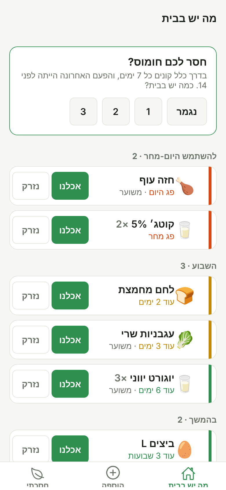
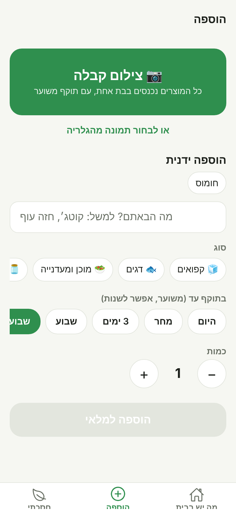
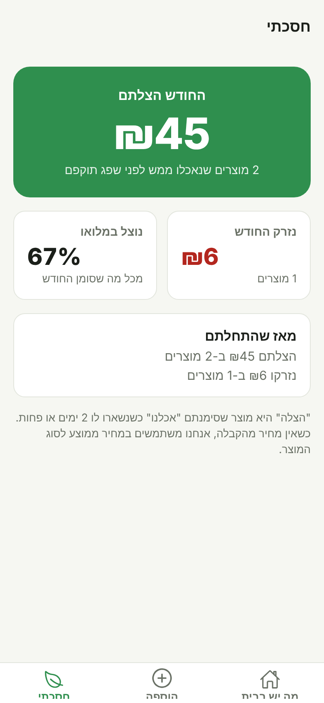

<div dir="rtl">

# freshly 🥬

**אפליקציה שעוזרת למשפחות להשתמש במה שכבר יש בבית לפני שזה מתקלקל.**

משק בית ישראלי זורק בממוצע אלפי שקלים של אוכל בשנה, בעיקר כי שוכחים מה יש במקרר ומתי זה פג. freshly מצלמת את הקבלה מהסופר, מעריכה לבד מתי כל מוצר יתקלקל, ומזכירה בזמן, כך שהאוכל נאכל ולא נזרק.

<p align="center">
  
  
  
</p>

## העיקרון: כמה שפחות מאמץ מהמשתמש

אפליקציות מלאי נכשלות כי הן דורשות להקליד כל מוצר. ב-freshly:

- **צילום קבלה אחד** מכניס את כל הקנייה. Claude קורא את הקבלה בעברית, מפענח שמות מקוצרים ("קוטג 5% 250 תנ") ומסווג כל מוצר.
- **התוקף מוערך אוטומטית** לפי סוג המוצר. אפשר לתקן בלחיצה ("מחר", "שבוע"), בלי לוח שנה.
- **התראה בבוקר שלפני התפוגה** עם שלושה כפתורים: *אכלנו*, *עוד יש*, *נזרק*. המלאי מתעדכן בלי לפתוח את האפליקציה.
- **לומדת הרגלי קנייה**: אם קונים קוטג' כל שבוע והפעם לא, היא שואלת "חסר לכם קוטג'? כמה יש בבית?" ועונים בלחיצה.
- **מסך "חסכתי"** מראה כמה כסף הצלתם החודש (מוצרים שנאכלו ממש לפני שפגו) וכמה נזרק.
- כפתורים גדולים, עברית מימין לשמאל, מצב כהה, ובלי הרשמה בגרסה הראשונה.

## מה כבר עובד

| יכולת | מצב |
|---|---|
| מלאי עם תוקף, ממוין לפי דחיפות (היום-מחר / השבוע / בהמשך) | ✅ |
| הוספה ידנית עם זיהוי סוג ותוקף אוטומטי מהשם | ✅ |
| צילום קבלה ← רשימת מוצרים לאישור | ✅ (צריך לפרוס את השרת, ראו למטה) |
| התראות לפני תפוגה עם כפתורי פעולה | ✅ |
| "חסר לכם X?" לפי הרגלי קנייה | ✅ |
| מסך חיסכון חודשי | ✅ |
| סנכרון בין בני הבית | בהמשך |
| מתכונים ממה שעומד לפוג | בהמשך |
| בוט וואטסאפ למי שלא רוצה עוד אפליקציה | בהמשך |

## טכנולוגיה

- **Expo (React Native) + TypeScript**: אפליקציה אחת לאנדרואיד, אייפון ו-web. ניווט עם Expo Router.
- **Zustand + AsyncStorage**: המלאי נשמר על המכשיר, עובד גם בלי אינטרנט.
- **expo-notifications**: התראות מקומיות עם כפתורי פעולה.
- **Supabase Edge Function + Claude API**: קריאת הקבלה רצה בשרת, כך שמפתח ה-API לא נמצא באפליקציה. התשובה חוזרת כ-JSON מובנה (structured outputs) ונבדקת מול סכמה.

```
src/
  app/            מסכים (Expo Router): מה יש בבית, הוספה, חסכתי, בדיקת קבלה, עריכת מוצר
  components/     רכיבי ממשק: שורת מוצר, בחירת תוקף, בחירת סוג, שאלת הרגל
  domain/         לוגיקה טהורה ונבדקת: קטגוריות, תאריכים, הערכת תוקף, חיסכון, הרגלים
  services/       מצלמה, קריאת קבלה, תזכורות
  store/          מצב האפליקציה
supabase/functions/parse-receipt/   השרת שקורא קבלות עם Claude
```

## הרצה

```bash
npm install
npx expo start          # סורקים את ה-QR עם Expo Go בטלפון
npm test                # בדיקות הלוגיקה
npm run typecheck
```

> התראות עם כפתורים וצילום ברזולוציה מלאה דורשים development build (`npx eas-cli build --profile development`). ב-Expo Go כל השאר עובד.

### הפעלת סריקת קבלות

1. פותחים פרויקט ב-[Supabase](https://supabase.com) (חינם).
2. ```bash
   supabase secrets set ANTHROPIC_API_KEY=sk-ant-...
   supabase functions deploy parse-receipt
   ```
3. מעתיקים את `.env.example` ל-`.env` וממלאים את כתובת הפונקציה ואת ה-anon key.

</div>

---

## English summary

**freshly** helps households eat what they already have before it spoils. Snap a supermarket receipt, and Claude reads the Hebrew line items, categorizes them and estimates each item's use-by date. The app then sends a morning-before reminder with one-tap *eaten / still have / thrown* actions, learns buying habits to ask "out of cottage cheese? how many are left?", and shows how much money was rescued this month.

Built with Expo (React Native, TypeScript, Expo Router), Zustand with on-device persistence, local notifications, and a Supabase Edge Function that calls the Claude API with structured outputs so the API key never ships in the app. Hebrew-first, RTL, large tap targets, no sign-up.

Run with `npm install && npx expo start`; tests with `npm test`.
